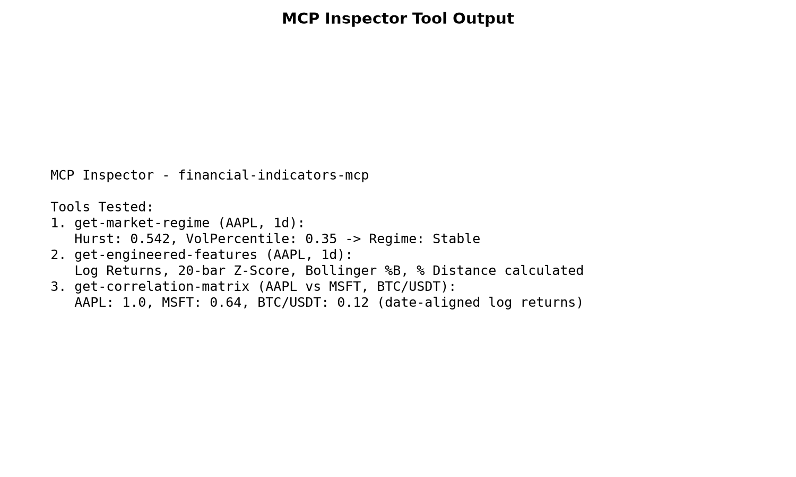

# financial-indicators-mcp

Market data, technical analysis, statistical regime detection, and risk metrics exposed as Model Context Protocol (MCP) tools for LLM agents.



## Why

LLMs analyzing market movements require structured, verifiable financial metrics rather than unstructured web search results. `financial-indicators-mcp` connects LLM agents directly to date-aligned returns, volatility-calibrated regime detection, and statistical risk estimators via the standard Model Context Protocol.

## How it works

The server exposes 11 tools communicating over standard input/output (stdio):

| Tool | Description |
|---|---|
| `get-price` | Fetch latest quote (price, day change, % change, day high/low, volume) from Yahoo Finance for equities or Binance via CCXT for crypto pairs. |
| `get-indicators` | Compute 14-period RSI, MACD (12, 26, 9), 20-period Bollinger Bands (±2σ), and statistical regime confidence matrix over close prices. |
| `plot-indicators` | Generate a 3-panel PNG chart showing price with 20-period Bollinger Bands, 14-period RSI, and MACD lines, annotated with detected market regime. |
| `get-market-news` | Fetch recent news articles (title, publisher, link, publish time) from Yahoo Finance search, optionally filtered by symbol. |
| `get-market-regime` | Classify the regime as Trending, Mean-Reverting, High-Volatility or Stable from a multi-window Hurst estimate (compared with simulated random walks) and the current volatility percentile. |
| `get-engineered-features` | Return log returns, the 20-bar z-score, Bollinger %B and the % distance from the 20-bar mean. |
| `get-headline-keyword-score` | Score recent Yahoo Finance headlines with a small keyword list from −1 (bearish) to 1 (bullish). A rough heuristic, not a language model. The raw headlines are returned too. |
| `simulate-trade` | Net P&L of one long trade after a 0.2% taker fee per side and slippage of 10% of the 14-day ATR. |
| `get-correlation-matrix` | Pearson correlation of log returns between a base symbol and each benchmark, aligned by date. null = not enough overlapping data. |
| `get-portfolio-risk-metrics` | Historical VaR at 95% and 99% (the 5th and 1st percentile of the returns you pass; negative = loss) and the Kelly fraction for your win rate and win/loss ratio. |
| `get-momentum-score` | Momentum score from −1 to 1: the % change over the window × 10, capped. A 10% move gives ±1. |

## Results

Command: `npm run build && node dist/scripts/eval-keywords.js Sentences_AllAgree.txt`

Evaluated on the Financial PhraseBank dataset (Malo et al., 2014):

| Metric | Measured Value |
|---|---|
| Sample size (sentences) | 2,264 |
| Keyword heuristic accuracy | 0.621 |
| Always-neutral baseline | 0.614 |

The simple keyword dictionary marginally exceeds the always-neutral baseline by 0.7 percentage points, demonstrating that word matching functions only as a rough baseline rather than a true sentiment model.

## Agent evaluation

Unit tests check the maths; [`evals/`](evals/README.md) checks whether an LLM agent uses the tools correctly. It has a 200-query benchmark (ambiguous tickers, multi-horizon regime comparisons, requests for guaranteed returns and more), deterministic Level 1 assertions on every tool call, and a pinned Level 2 binary judge for "unhedged financial advice when the signals conflict".

Runs of 2026-11-08 on Ollama Cloud, market data recorded 2026-11-07 (`npm run eval:run [-- --model gemma4:31b]`, then `npm run eval:l1`):

| Metric | `beam:cloud` | `gemma4:31b` |
|---|---|---|
| Level 1 pass rate | 181 / 200 (90.5%) | 189 / 200 (94.5%) |
| Most common failure | RSI period passed as `limit` (10 traces) | `limit: 1` for "the current value" (7 traces) |
| Schema-breaking calls recovered | 8 of 9 traces | none made |
| Level 2 judge flags (unhedged advice) | 4 / 200 | 4 / 200 |

Judge vs reference labels: **human agreement pending** (no human labels yet). Against labels written by the AI coding agent that built the harness (400 traces, 3 FAIL), the judge found all 3 and raised 5 more (kappa 0.54). That is model-to-model agreement, not a human measurement, and too few FAILs for the split-based calibration. Details in [`evals/README.md`](evals/README.md#results).

## Quickstart

```bash
git clone https://github.com/thekogit/financial-indicators-mcp.git
cd financial-indicators-mcp
npm ci
npm run build
npx @modelcontextprotocol/inspector node dist/index.js
```

Configure in Claude Desktop or an MCP client:

```json
{
  "mcpServers": {
    "financial-indicators": {
      "command": "node",
      "args": ["/absolute/path/to/financial-indicators-mcp/dist/index.js"]
    }
  }
}
```

## Tests

```bash
npm test
```

The tests never touch the network: the server is exercised over an in-memory MCP transport with synthetic market data.

## Limitations

- Yahoo Finance is an unofficial API with delayed data
- No built-in authentication or rate-limit tokens on endpoints
- Hurst exponent estimation on 100 bars remains noisy
- The headline keyword scorer is a simple baseline heuristic
- Not financial or investment advice

## How I used AI

I used Antigravity to draft parts of the code. I chose the architecture, reviewed every change, rewrote the Hurst calibration and date-aligned return correlation, and wrote the test suite in `src/` to verify calculations. Agent-made commits are visible in the git history.

The evaluation harness in `evals/` and `src/evals/` (benchmark prompts, assertions, judge rubric and calibration code) was written by Claude Code, an AI coding agent, from my plan. The benchmark agents (`beam:cloud`, `gemma4:31b`) and the judge (`beam:cloud`) are themselves LLMs. At my request Claude also labelled the 400 traces for the judge's criterion; those labels are marked `labeler_kind: "ai_agent"` and are reported separately from human labels, which have not been collected yet.

## License

MIT License. See [LICENSE](LICENSE) for details.
